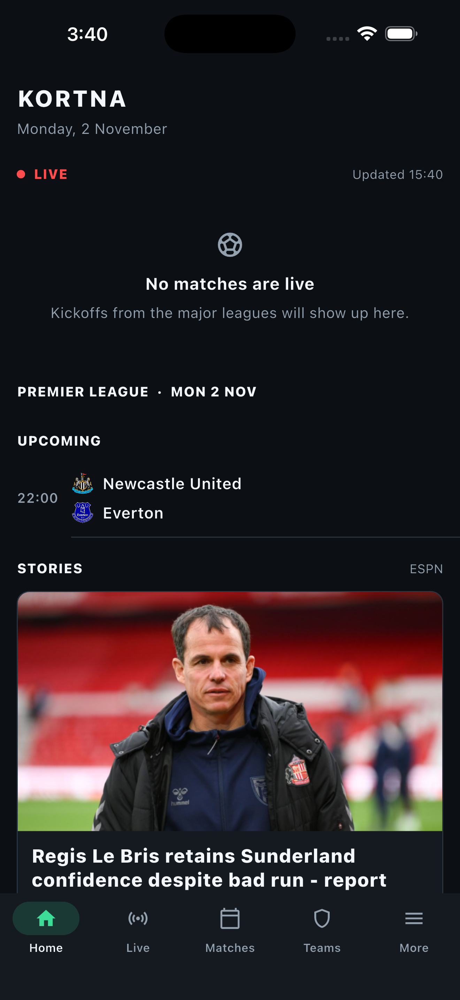
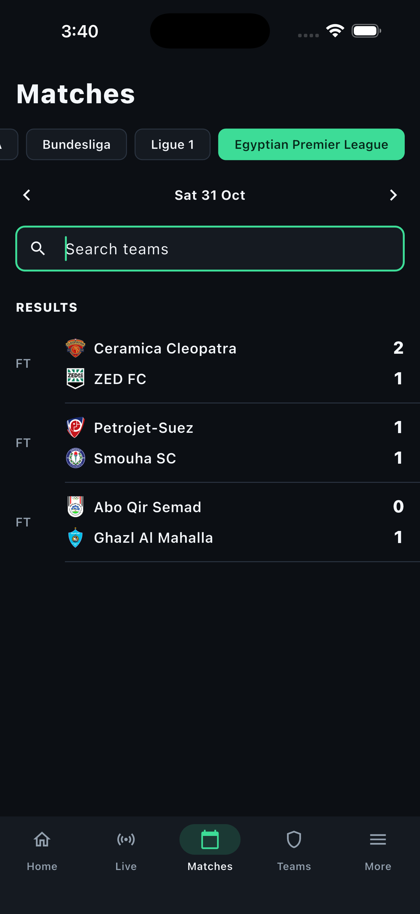
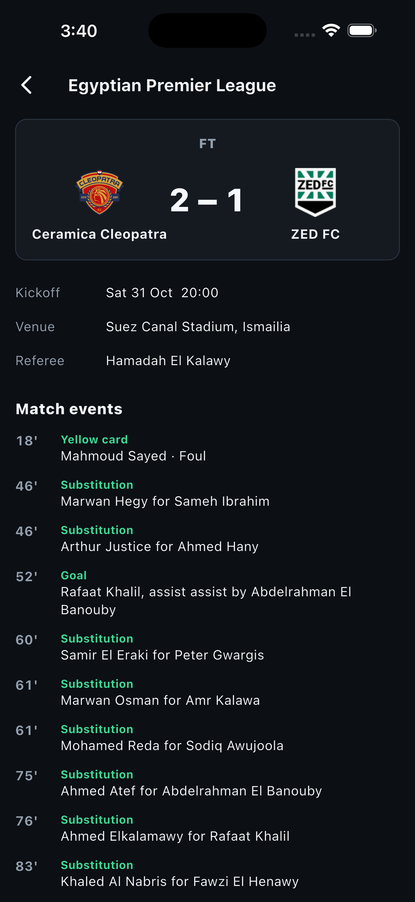
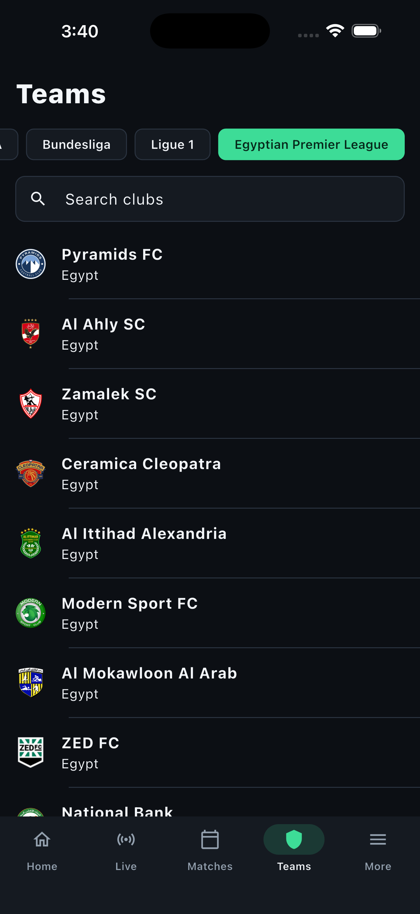
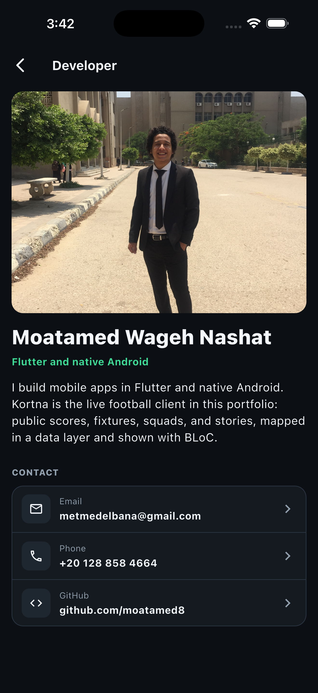

# Kortna

Live football on your phone. Scores, fixtures, clubs, and stories for the Premier League, Champions League, La Liga, Serie A, Bundesliga, Ligue 1, and the Egyptian Premier League.

Screenshots from iPhone 17 Pro Max.

<p align="center">
  
  
  
</p>

<p align="center">
  
  
</p>

## The app

- **Home** shows what is live, the day's fixtures, and stories.
- **Live** follows matches that are in play and pauses when you leave the screen.
- **Matches** switches leagues and dates, and searches by team. Open a match for the score, venue, referee, and events.
- **Teams** lists the clubs in the selected league, with the squad and results on the club page.
- **More** sets light, dark, or system appearance, and opens stories, injuries, and the developer profile.

Built by Moatamed Wageh Nashat.

## Run

```bash
flutter pub get
flutter test
flutter run
```
